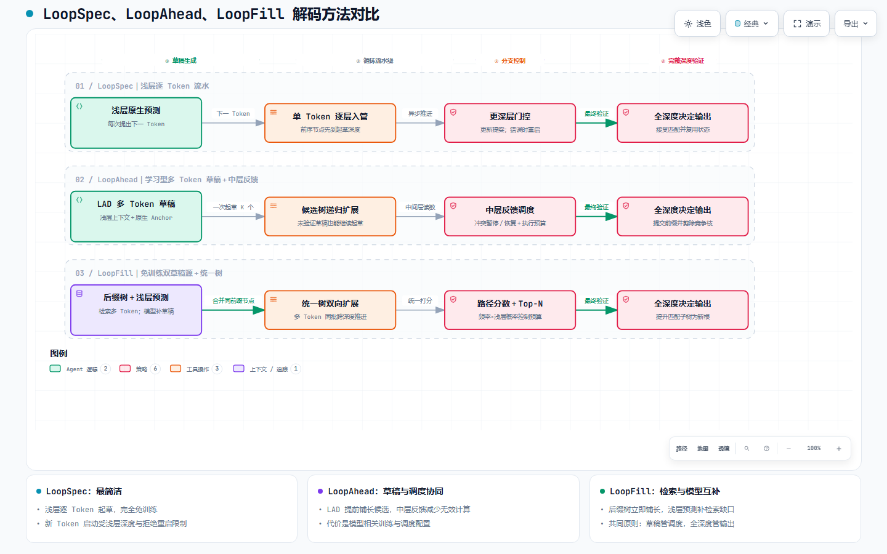

# Looped Transformer 投机解码方法分析报告

**主题：LoopSpec、LoopAhead 与 LoopFill 的机制、流程和差异**

**整理日期：2026-11-24**

## 摘要

Looped Transformer 通过反复应用共享 Transformer block，在较少参数下增加有效计算深度，但自回归生成每个 Token 都需要完成多次顺序循环，导致较高解码延迟。LoopSpec、LoopAhead 和 LoopFill 都试图把原本串行的循环计算转换为跨 Token、跨循环深度的并行计算，同时保留完整深度模型的最终决策权。

三者的主要差异在于草稿来源和候选调度方式：

- **LoopSpec** 直接使用目标模型的浅层预测，免训练地逐 Token 提前启动后续计算，并以更深的第二提案减少错误草稿导致的流水线重启。
- **LoopAhead** 训练轻量级 LookAhead Drafter（LAD），根据浅层上下文和原生 Anchor 一次预测多个未来 Token，再利用中间层反馈暂停、恢复和执行候选分支。
- **LoopFill** 将后缀树检索的多 Token 草稿与浅层原生预测合并到统一草稿树，通过路径评分和 Top-N 预算控制计算，无需额外训练。

本报告逐篇分析其方法，并通过具体表格示例说明 LoopSpec 的双提案流水线、LoopAhead 的 LAD 起草与冲突暂停，以及 LoopFill 的双草稿源协同与连续 Token 提交。

---

## 1. 背景与统一问题框架

### 1.1 Looped Transformer 的顺序瓶颈

设共享 recurrent backbone 为 $F$，输入初始隐藏状态为 $H^{(0)}$，则循环计算为：

```math
H^{(r)}=F(H^{(r-1)}),\qquad r=1,\ldots,R
```

完整深度输出由：

```math
p_R(\cdot\mid X)=\mathcal C(H_X^{(R)})
```

给出，其中 $\mathcal C$ 包含后处理层、LM head 和 softmax。普通自回归解码必须先完成当前 Token 的全部 $R$ 次循环，才能把它加入前缀并开始下一个 Token，因此生成每个 Token 都需要 $R$ 个顺序循环阶段。

中间循环状态也可以经过同一个 readout 得到：

```math
p_r(\cdot\mid X)=\mathcal C(H_X^{(r)}),\qquad r\lt R
```

虽然浅层分布通常不如完整深度分布可靠，但它与最终结果往往具有较高一致性。三种方法都利用这一点，只是使用方式不同。

### 1.2 投机的基本思想

投机解码将计算拆成两个角色：

1. **草稿**：低成本地提出未来 Token；
2. **验证**：由完整深度目标模型决定真正输出。

在 Looped Transformer 中，还可以让当前 Token 的深层验证与未来 Token 的浅层计算同时进行。不同分支虽然处于不同循环深度，但共享同一个 backbone，因此能够在一次 batched call 中推进。

### 1.3 “无损”的含义

三种方法中的无损均不表示草稿始终正确，而表示：

- 贪心解码下，最终输出与完整深度自回归解码一致；
- 采样解码下，通过提案接受和残差修正，保持目标模型的输出分布。

草稿只影响**哪些计算提前发生**，不能绕过完整深度模型决定最终 Token。

---

## 2. 三种方法总览



[下载交互版对比图](../assets/loop-decoding-comparison.html)，可用浏览器打开并缩放查看。

| 维度 | LoopSpec | LoopAhead | LoopFill |
|---|---|---|---|
| 核心草稿 | 浅层原生预测 | 学习型 LAD | 后缀树＋浅层预测 |
| 单次前瞻 | 主要为下一 Token | 多个未来 Token，可递归扩展 | 后缀检索一次提出多个 Token |
| 额外训练 | 无 | 需要为目标模型训练 LAD | 无 |
| 分支控制 | 第二提案、门控、级联验证 | 中层反馈、暂停／恢复、执行预算 | 路径评分、Top-N 保留 |
| 最终验证 | 完整深度 $R$ | 完整深度 $R$ | 完整深度 $T$ |
| 主要开销 | 错误分支与重启 | LAD 推理、训练和候选执行 | 检索与额外草稿节点 |
| 主要优势 | 简单、直接、免训练 | 前瞻长，调度细 | 多 Token 与免训练兼得 |

---

## 3. LoopSpec：浅层自投机与双提案流水线

原始论文：[LoopSpec: Pipelined Self-Speculative Decoding for Looped Transformers](../papers/2609.17184v1_LoopSpec.pdf)。

### 3.1 单第一提案流程

设第一提案深度为 $d_1\lt R$。分支到达 $d_1$ 时，模型读取：

```math
q_1=p_{d_1}=\mathcal C(H^{(d_1)})
```

并产生候选 $\widetilde x^{(1)}$。LoopSpec 随即创建以“当前前缀＋候选 Token”为输入的子分支，而父分支继续向 $R$ 推进。

因此，原分支验证当前 Token 时，子分支已经在计算下一个 Token。若完整深度验证接受草稿，子分支已经完成的循环和 KV 状态均可复用；若拒绝，则删除其投机后代，并从纠正后的前缀重新开始。

当第一提案持续被接受时，Token 可以约每 $d_1$ 个循环步提交一次，而不是每 $R$ 步一次，理论串行加速受 $R/d_1$ 限制。但每次拒绝都可能丢弃已经完成的投机工作，形成流水线气泡。

### 3.2 残差第二提案

为减少第一草稿被拒绝后的重启，LoopSpec 在更深深度 $d_2$ 提供备选提案，其中：

```math
d_1\lt d_2\lt R
```

第二提案不是简单复制 $p_{d_2}$，而是使用：

```math
q_2=p_{d_2}\ominus p_{d_1}
```

残差操作的核心为：

```math
(\mu\ominus\nu)(v)\propto\max(\mu(v)-\nu(v),0)
```

其直觉是：第二提案主要服务于“第一提案被拒绝以后”的情况，因此应估计第一提案概率质量被移除后的剩余目标分布。

### 3.3 门控机制

如果每个分支都在两个深度分裂，候选数量会迅速增长。LoopSpec 仅在更深层状态降低对第一草稿的信心时开启第二提案：

```math
\widetilde q_2(\widetilde x^{(1)})\lt q_1(\widetilde x^{(1)})
```

在贪心解码下，可理解为：当 $d_2$ 的 argmax 与第一草稿不同，才创建备选分支。这样可在保留回退路径的同时限制分支膨胀。

### 3.4 级联验证

完整深度分布 $p_R$ 就绪后，验证顺序为：

1. 验证第一提案；接受则保留其子树并删除第二子树；
2. 第一提案被拒绝后，针对残差目标验证第二提案；
3. 两者都拒绝时，从剩余残差分布产生纠正 Token，删除错误后代并重启正确分支。

在贪心解码下，这等价于检查完整深度 argmax 是否匹配第一或第二候选；都不匹配时直接提交完整深度结果。

### 3.5 具体示例：France／Paris

设：

- Prompt：`The Capital of France is`；
- 正确续写：`Paris and it`；
- $R=4,d_1=1,d_2=2$。

R1 首先猜出 `France`，并立即启动 `Prompt＋France` 分支。R2 对 `France` 的信心下降，产生备选 `Paris`，又启动 `Prompt＋Paris` 分支。主要调度如下：

| 循环步 | 原分支 A | France 分支 B | Paris 分支 C | `Paris and` 分支 D | 结果 |
|---|---|---|---|---|---|
| 1 | R1：起草 France | 创建 | — | — | 无输出 |
| 2 | R2：起草 Paris | R1 | 创建 | — | 无输出 |
| 3 | R3 | R2 | R1：起草 and | 创建 | 无输出 |
| 4 | R4：确认 Paris | 剪掉 | R2 | R1：起草 it | 提交 Paris |
| 5 | 结束 | — | R3 | R2 | 继续 |
| 6 | 结束 | — | R4：确认 and | R3 | 提交 and |
| 7 | 结束 | — | 结束 | R4：确认 it | 提交 it |

普通 AR 需要 12 步，仅第一提案需要 9 步，双提案在该示例中需要 7 步。关键在第 4 步：正确 `Paris` 分支已经在第 2 步启动，因此验证接受时已完成 R2，而不是从 R0 重启。

### 3.6 优势与局限

**优势**：无需训练、无需外部草稿模型、机制直接，且第二提案能显著减少完全重启。

**局限**：每次原生预测主要推进一个 Token；更早但不可靠的第一提案会制造无效分支，错误草稿仍会造成流水线气泡。

---

## 4. LoopAhead：学习型多 Token 草稿与反馈调度

原始论文：[LoopAhead: Speculating Ahead for Faster Decoding in Looped Language Models](../papers/2610.21594v1_LoopAhead.pdf)。

### 4.1 为什么需要 LAD

LoopSpec 的后续 Token 必须等前序候选运行到指定浅层深度后才能逐一启动。LoopAhead 希望一次铺出更长的未来候选，同时避免错误长链持续消耗计算。

其分工为：

- 浅层：生成原生 Anchor，并为 LAD 提供目标模型特征；
- 中间层：检查候选路径是否冲突；
- 完整深度：最终验证和提交。

### 4.2 LAD 的输入与结构

LAD 使用最近 $w$ 个位置的浅层目标状态：

```math
H_t^{(r)}=[h_{t-w+1}^{(r)},\ldots,h_t^{(r)}]
```

以及目标模型在浅层产生的原生 Anchor $a_t$：

```math
a_t=\underset{v\in\mathcal V_{\mathrm{tgt}}}{\arg\max}\,[W_{\mathrm{out}}h_t^{(r)}]_v
```

其中 $W_{\mathrm{out}}$ 是冻结的目标词汇表投影，$\mathcal V_{\mathrm{tgt}}$ 是完整目标词表。Anchor 不需要先通过完整深度验证，其 embedding 用于告诉 LAD 从哪个候选 Token 后继续预测。

LAD 将上下文投影到较小隐藏空间，为未来位置添加 query。每个 query 融合 Anchor embedding、最新上下文和位置编码，再由轻量因果 Transformer 一次前向计算多个未来位置：

```math
\widehat h_{t,j}=h_t^{(r)}+D_{\phi,j}(H_t^{(r)},E(a_t)),\qquad j=1,\ldots,K
```

随后复用冻结的目标词汇表投影：

```math
q_{\phi,j}=\operatorname{softmax}(W_{\mathrm{out}}\widehat h_{t,j}),\qquad j=1,\ldots,K
```

其中 $q_{\phi,j}$ 是未来位置 $t+j$ 的草稿分布，$K$ 是单次 LAD 调用额外预测的 Token 数。

基础 LAD 为两层、隐藏维度 512 的 Transformer。训练最多监督 7 个未来位置；部署时使用更短扩展，Ouro 和 Raven-TinyLlama 每次增加 3 个 Token，Raven-Llama／OLMo 增加 2 个。

### 4.3 训练与紧凑词表

训练数据来自冻结目标模型的完整深度贪心轨迹，包括数学、代码、推理和通用对话等 9,025 个混合领域 Prompt。目标模型、Token embedding 和输出投影保持冻结，LAD 通过未来位置的交叉熵训练。

推理时，LAD 使用请求相关的紧凑词表：8,192 个高频训练输出 Token，加上停止、Prompt 和已提交 Token。紧凑词表只降低草稿投影成本；原生提案和最终验证仍使用完整目标词表。

### 4.4 候选树与中层反馈

原生提案和 LAD 草稿进入同一棵候选树。节点保存 Token、父节点、隐藏状态、KV cache 和循环深度；同父同 Token 的候选共享节点。不同节点可在同一 batch 中从不同深度继续推进。

父节点的中间层 readout 可预测其子节点所代表的 Token。贪心情况下，如果子节点与父节点最深可用反馈不同，该路径被视为冲突。调度器执行：

1. **执行**：在 $B_{\mathrm{exe}}$ 预算内推进无冲突或受保护节点；
2. **暂停／恢复**：暂停冲突路径，但保留状态；反馈消除冲突或进入根附近保护区后恢复；
3. **剪枝**：完整深度验证后保留匹配子树，删除竞争分支；
4. **保留预算**：通过 $B_{\mathrm{ret}}$ 限制整棵树的节点数。

暂停而不是立即删除，使暂时冲突的路径仍有恢复机会。

### 4.5 具体示例：代码生成中的 LAD 起草与冲突暂停

以下对论文表 9 的 MBPP 案例做机制化简。原案例的输出为：

```python
return [t for t in tuples if all(i % k == 0 for i in t)]
```

这里只考察局部续写：根节点代表已验证到 `... == 0` 的前缀，接下来的正确 Token 序列是 `for i in t`。

设 Ouro 使用 R4 完整验证、R1 起草、R2 中间反馈。R1 首先在根节点产生尚未验证的原生 Anchor `for`；以该 Anchor 为条件，LAD 再一次提出 `i`、`in`、`lst` 三个候选，形成 `for（原生 Anchor）→ i → in → lst` 的候选链。其中 `i`、`in` 与目标一致，`lst` 是错误候选，完整深度模型最终会把它纠正为 `t`。

为突出调度机制，下表假设各活跃节点每步推进一层，并省略其他候选、递归扩展和预算细节；它不是对完整请求的逐步复现。

| 循环步 | 目标模型与候选节点 | 中层反馈与调度 | 验证／提交结果 |
|---|---|---|---|
| 1 | 根节点到 R1，产生原生 Anchor `for`；LAD 继续预测 `i`、`in`、`lst` | 建立 `for → i → in → lst` 候选链，后续节点开始提前计算 | 尚无输出 |
| 2 | 根节点到 R2；`for`、`i`、`in`、`lst` 到 R1 | 根的反馈仍支持 `for`，候选链继续执行 | 尚无输出 |
| 3 | 根节点到 R3；`for`、`i`、`in` 到 R2 | `in` 的反馈倾向 `t`，与 `lst` 冲突；暂停 `lst`，但保留其状态 | 尚无输出 |
| 4 | 根节点到 R4，确认输出 `for`；`for`、`i`、`in` 到 R3 | 保留匹配路径，错误后缀继续暂停 | 提交 `for`，`for` 节点成为新根 |
| 5 | `for` 到 R4并确认 `i`；`i` 到 R4并确认 `in`；`in` 也到 R4并确认 `t` | 保留 `for → i → in` 的计算，剪除 `lst`；为纠正 Token `t` 创建正确分支 | 同一步依次提交 `i`、`in` 和 `t` |

这个例子体现了 LoopAhead 的三个关键动作：

1. **LAD 提前铺长**：`i`、`in` 等未来 Token 在当前根节点验证前就已开始计算；
2. **中层反馈节省计算**：`lst` 在完整深度验证前就被暂停，避免继续浪费循环；
3. **完整深度纠正并复用**：最终输出 `for i in t` 而非以 `lst` 结尾，但正确的 `for`、`i`、`in` 分支计算仍被保留。

论文对应的完整 MBPP 案例中，LoopSpec 使用 40 个循环、耗时 269.7 ms；LoopAhead 使用 23 个循环、耗时 185.8 ms，吞吐量提高 45.2%，且两种方法产生相同输出。

### 4.6 递归起草与验证复用

LAD 产生的草稿节点到达浅层起草深度后，可以产生自己的 Anchor 并再次调用 LAD。也就是说，第一段草稿尚未验证，第二段草稿已经可以开始，从而突破单次调用长度 $K$ 的限制。

完整深度验证最终选择输出。匹配子节点成为新根，并保留其隐藏状态、KV cache 和后代；如果新根的完整深度 readout 已就绪，同一步还能继续提交后续 Token。

### 4.7 优势与局限

**优势**：多 Token 前瞻更早、更长；中层调度可减少错误候选运行到完整深度的浪费。

**局限**：需要模型相关训练和调度配置；LAD 本身有开销，草稿质量差时额外候选可能抵消收益。论文消融显示，单独加入 LAD 不一定加速，LAD 与反馈调度是互补关系。

---

## 5. LoopFill：后缀检索与浅层预测的统一草稿树

原始论文：[LoopFill: Pipelined Multi-Token Speculative Decoding for Looped Transformers](../papers/2611.19649v1_LoopFill.pdf)。

### 5.1 要解决的问题

LoopSpec 的逐 Token 提案受浅层深度和拒绝重启限制；普通 Suffix Decoding 虽能一次提出多个 Token，但通常按完整验证轮次推进，不能充分利用循环流水线。LoopFill 希望无需训练就同时获得：

- 后缀树的多 Token 前瞻；
- 浅层预测的模型驱动补全；
- 跨 Token、跨深度的流水执行。

### 5.2 双草稿源

**后缀树检索**使用两类数据：

- 局部树：当前请求的 Prompt 和已生成内容；
- 全局树：已完成请求的输出。

当前前缀的不同长度后缀与历史文本匹配后，检索其后续 Token 并构造候选子树。论文最长检查 64 个 Token，每次检索最多加入 $Q$ 个节点，默认 $Q=4$。后缀检索不消耗目标模型的循环计算，却能让多个未来 Token 同时进入流水线。

**浅层预测**在节点到达指定深度 $d\lt T$ 时，对其隐藏状态应用 LM head，取 top-k 候选，默认 $k=2$。它既可以从后缀路径继续预测，也能在历史检索失败时提供模型驱动的补充。

### 5.3 统一树与双向扩展

两种来源向同一棵树添加节点，同父同 Token 时合并计算。其协同不是简单的“检索失败后回退”，而是：

- 后缀节点到达浅层深度后，由模型继续扩展；
- 浅层预测产生新 Token 后，以其为前缀再次查询后缀树。

因此，后缀树负责立即铺长，浅层预测负责接续和补足检索缺口。

### 5.4 路径评分与节点预算

后缀边的初始权重为：

```math
w(v)=\min\{1,cq(v)\}
```

其中 $q(v)$ 是在父节点的历史匹配中继续经过子节点 $v$ 的频率，参数 $c$ 控制后缀草稿相对权重。浅层预测后，top-k 子节点使用模型概率，其余候选权重置零。

任意非根节点 $v$ 的路径分数按从根到该节点的边权重连乘计算，根节点初始分数为 1：

```math
s(\mathrm{root})=1,\qquad
s(v)=s(\operatorname{parent}(v))\,w(v)
```

每轮重新排序并保留最多 $N$ 个非根节点，默认 $N=16$。父节点优先于子节点，因此保留一个节点时，其到根的完整路径也会保留。每个请求每步最多占用 $N+1$ 个计算位置，避免无限草稿挤占其他请求。

### 5.5 具体示例：I would like

以下对应论文图 2 和图 3 的简化示例。已验证前缀为：

```text
I would like
```

目标续写为：

```text
to join Lean Club \n
```

设完整循环深度为 3，浅层起草深度为 1。后缀树和浅层预测向同一棵草稿树添加节点；为便于阅读，下表省略低分备选节点及部分 KV 状态变化。

| 循环步 | 跨深度并行计算 | 双草稿源与统一树调度 | 验证／提交结果 |
|---|---|---|---|
| 1 | 根节点 `like` 到 R1 | 浅层预测提出 `to`；后缀检索提出 `a → coffee`。统一评分后，`a` 不在浅层 top-2 中，其路径被降权并剪除 | 尚无输出 |
| 2 | `like` 到 R2；`to`、`join`、`Lean` 等节点到 R1 | 以浅层草稿 `to` 为新前缀再次检索，加入 `join → Lean → Hub`；多个未来 Token 同批进入流水线 | 尚无输出 |
| 3 | `like` 到 R3；`to`、`join`、`Lean` 到 R2；`Club` 到 R1 | 浅层预测从 `Lean` 继续提出 `Club`，保留高分路径 | 完整深度确认 `to`，提交 `to` 并复用其子树 |
| 4 | `to`、`join`、`Lean` 同时到 R3；`Club` 到 R2 | 三个连续候选都已完成验证，保留匹配链并剪除 `Hub` 等竞争分支 | 同一步连续提交 `join`、`Lean`、`Club` |
| 5 | `Club` 到 R3 | 保留其后续候选及已完成状态 | 完整深度确认并提交换行符 `\n` |

论文图示中，生成这 5 个 Token：

- 普通自回归解码需要 15 个循环步；
- LoopSpec 和 Suffix Decoding 各需要 9 个循环步；
- LoopFill 只需要 5 个循环步。

第 4 步最能体现 LoopFill 的特点：`join`、`Lean`、`Club` 并不是等前一个 Token 验证后才开始，而是早已在统一草稿树中并行完成循环，因此能够在同一步连续提交。后缀树负责一次铺长，浅层预测负责继续补全，完整深度验证则保证最终输出不变。

### 5.6 验证与状态复用

根节点完成全部 $T$ 次循环后，完整深度分布决定真正输出。若某个子节点匹配：

- 将其提升为新根；
- 保留已完成循环、隐藏状态、KV cache 和后辈子树；
- 删除其他竞争分支。

若新根已经完成全部循环，可以立即继续输出；多个连续节点同时完成时，一个循环步可提交多个 Token。

### 5.7 优势与局限

**优势**：免训练、多 Token、统一调度和状态复用；后缀命中时间隔接近零，浅层命中则在后缀失效时提供补充。

**局限**：高不可预测文本中后缀命中率下降；较大节点预算虽然可能降低单请求延迟，却会在高并发时挤占其他请求并降低吞吐量。

---

## 6. 横向对比与理解框架

### 6.1 草稿产生方式

- LoopSpec：**模型自己逐 Token 猜**；
- LoopAhead：**训练一个草稿器，根据模型浅层特征一次猜多个**；
- LoopFill：**历史检索猜一段，模型浅层预测补一段**。

### 6.2 分支控制方式

- LoopSpec 关注“第一草稿错误时，是否已有第二分支可保留”；
- LoopAhead 关注“哪些分支应继续、暂停、恢复或执行”；
- LoopFill 关注“统一树中哪些节点值得占用下一轮计算位置”。

### 6.3 计算复用方式

三者都不会在验证后简单丢弃全部工作，而是尽可能保留匹配子树的状态。差异在于：

- LoopSpec 主要复用第一或第二提案所在分支；
- LoopAhead 可恢复暂停分支，并保留递归扩展的计算；
- LoopFill 保留统一树中匹配节点及其后代。

### 6.4 适用场景

| 场景 | 更值得考虑的方法 | 原因 |
|---|---|---|
| 不希望训练或修改模型 | LoopSpec／LoopFill | 都是免训练推理时方法 |
| 文本具有较多历史重复模式 | LoopFill | 后缀检索可立即提供长草稿 |
| 需要更强的模型相关多 Token 前瞻 | LoopAhead | LAD 可学习目标任务与模型特征 |
| 希望实现最简单 | LoopSpec | 草稿与验证均来自原生循环 readout |
| 草稿分支很多、需要细粒度控制 | LoopAhead | 中层反馈和暂停／恢复机制更丰富 |
| 高并发服务 | 需谨慎评估预算 | 额外候选都会与其他请求竞争计算 |

### 6.5 实验数字不能直接跨论文排名

原论文分别报告了有吸引力的结果：LoopSpec 最高报告 6.83×；LoopAhead 在其设置中最高报告 7.82×；LoopFill 报告贪心平均加速 5.85×（Ouro-2.6B）和 5.13×（Huginn-3.5B）。

这些数字来自不同硬件、模型、任务、并发和实现设置，**不能直接当作严格的跨论文排名**。比较时应优先看方法机制，再在统一推理引擎和相同工作负载下复测。

### 6.6 相对 DFlash 的收益及原因

DFlash 也能通过块扩散草稿器一次生成多个候选 Token，因此，三种 loop-aware 方法的优势并不只是“能够多 Token 起草”，而在于它们能把草稿嵌入 Looped Transformer 的循环流水线，并利用中间循环状态降低草稿成本或减少无效计算。

下表采用 LoopFill 论文的统一实验设置。表内数字本身是**相对 AR 的解码延迟加速**，括号是根据论文均值计算的**相对 DFlash 收益**；例如 5.85× 是相对 AR 的加速，而相对 DFlash 的收益是约 72%，不是 5.85 倍。

| 模型与解码方式 | DFlash | LoopSpec | LoopAhead | LoopFill |
|---|---:|---:|---:|---:|
| Huginn-3.5B，贪心 | 3.73× | 3.93×（+5%） | 4.12×（+10%） | 5.13×（+38%） |
| Ouro-2.6B，贪心 | 3.40× | 3.22×（−5%） | 4.19×（+23%） | 5.85×（+72%） |
| Huginn-3.5B，采样 | 2.33× | 2.09×（−10%） | 2.37×（+2%） | 2.60×（+12%） |
| Ouro-2.6B，采样 | 2.31× | 2.38×（+3%） | 3.25×（+41%） | 3.50×（+52%） |

收益主要来自以下四个方面：

1. **循环流水线减少顺序等待**：DFlash 的块扩散起草与目标验证相对分离，而 LoopSpec、LoopAhead、LoopFill 能让当前 Token 的深层验证与未来 Token 的浅层计算在同一个 batch 中推进，减少跨 Token 的等待。
2. **草稿生成成本更低**：LoopSpec 直接使用目标模型浅层 readout，LoopFill 的多 Token 部分主要来自后缀检索；LoopAhead 虽然需要训练，但其 LAD 更轻量。在 LoopAhead 论文配置中，Ouro 的 DFlash 草稿器为 277.9M 参数、LAD 为 11.1M；Raven-Llama 分别为 325.1M 和 19.5M。
3. **减少错误候选上的无效计算**：LoopSpec 用第二提案减少重启，LoopAhead 用中层反馈提前暂停冲突路径，LoopFill 用路径评分和 Top-N 控制节点预算。它们不仅争取接受更多草稿，也尽量避免错误草稿持续消耗目标模型计算。
4. **降低模型与任务适配成本**：DFlash 需要针对目标模型训练块扩散草稿器。LoopFill 论文的 DFlash 基线使用 50,000 个训练样本，LoopAhead 则使用 9,025 个 Prompt 收集教师轨迹。若草稿器与循环表示或任务分布适配不好，接受率下降会进一步放大草稿与验证成本。

三种方法的收益来源并不相同：

- **LoopSpec**：主要省去独立草稿器并利用循环流水，但逐 Token 前瞻和错误分支控制较弱。在 LoopFill 的复现中，其相对 DFlash 收益为 −10%～+5%，并不总是领先；LoopSpec 原论文在自身思考模型与实现设置下则报告最高 1.7× 于 DFlash，说明结果依赖具体基线和任务。
- **LoopAhead**：以轻量 LAD 换取多 Token 前瞻，并用中层反馈减少无效执行。其原论文的 30 个贪心模型—基准组合均超过 DFlash 适配基线；在 Raven-TinyLlama／HumanEval 的极端案例中，LoopAhead 为 7.82×、DFlash 为 1.37×，前者吞吐量约为后者的 5.7 倍。这更多反映该 DFlash 配置效率较低，不能视为普遍收益。
- **LoopFill**：后缀树以很低的目标模型计算成本铺长候选，浅层预测补足检索缺口，因此在其统一实验中收益最稳定。但高并发下额外草稿会与其他请求竞争算力：在 $B=16$ 时，LoopFill 相对 DFlash 的吞吐量收益在 Ouro 上约为 24%，在 Huginn 上约为 9.9%，低于单请求贪心延迟实验中的 72% 和 38%。

因此，这些方法相对 DFlash 的本质收益可以概括为：**更低的草稿成本＋更充分的循环流水利用＋更少的无效候选计算**。上述 DFlash 结果来自各论文的本地适配和特定实验设置，不代表 DFlash 在所有模型、任务或标准 Transformer 上都会处于劣势。

---

## 7. 总结

三种投机解码方法可以统一理解为：**利用浅层或历史信息提前组织未来计算，再由完整深度模型进行无损验证。**

- LoopSpec 是最基础的自投机流水线，重点解决“如何提前启动下一 Token，以及第一草稿错误后如何回退”；
- LoopAhead 在此基础上引入学习型多 Token 草稿和反馈调度，重点解决“如何更早铺长候选并减少无效执行”；
- LoopFill 则用后缀检索替代学习型草稿器，重点解决“如何免训练地获得多 Token 前瞻，并与浅层预测协同填管”。

从工程角度看，没有绝对最优方法：草稿质量、重复文本比例、循环深度、硬件并行能力、请求并发和节点预算都会改变收益。真正的评估应在同一模型、同一引擎和相同服务负载下，联合测量延迟、吞吐量、每个输出 Token 的循环次数以及被丢弃候选的计算比例。

---

## 附录 A：原始论文

1. Cho, S., Cui, L., Kim, S., Han, D., & Han, I. **LoopSpec: Pipelined Self-Speculative Decoding for Looped Transformers**. arXiv:2609.17184v1, 2026. [本地论文](../papers/2609.17184v1_LoopSpec.pdf)；[arXiv](https://arxiv.org/abs/2609.17184)。
2. Liu, Z., Xue, N., Bao, R., Xu, Y., Cao, X., Yao, J., & Chen, Z. **LoopAhead: Speculating Ahead for Faster Decoding in Looped Language Models**. arXiv:2610.21594v1, 2026. [本地论文](../papers/2610.21594v1_LoopAhead.pdf)；[arXiv](https://arxiv.org/abs/2610.21594)。
3. Zhu, S., Huang, S., Zhao, Y., & You, J. **LoopFill: Pipelined Multi-Token Speculative Decoding for Looped Transformers**. arXiv:2611.19649v1, 2026. [本地论文](../papers/2611.19649v1_LoopFill.pdf)；[arXiv](https://arxiv.org/abs/2611.19649)。

## 附录 B：常见符号

| 符号 | 含义 |
|---|---|
| $R$ 或 $T$ | 目标模型的完整循环深度 |
| $d_1,d_2,d$ | 草稿或中间反馈所在的较浅循环深度 |
| $p_r$ | 第 $r$ 层循环状态的下一 Token 分布 |
| $q_1,q_2$ | 第一、第二提案分布 |
| LAD | LoopAhead 的 LookAhead Drafter |
| $K$ | 单次 LAD 调用的额外草稿 Token 数 |
| $N$ | LoopFill 每请求保留的草稿节点预算 |
| $Q$ | LoopFill 单次后缀检索加入的节点预算 |
| $B_{\mathrm{ret}}$ | LoopAhead 候选树保留预算 |
| $B_{\mathrm{exe}}$ | LoopAhead 每批执行节点预算 |
